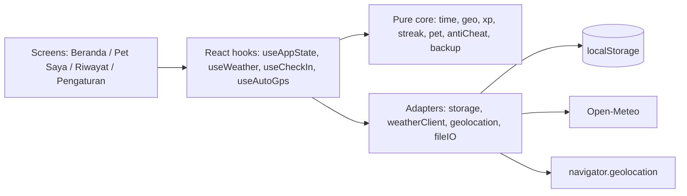
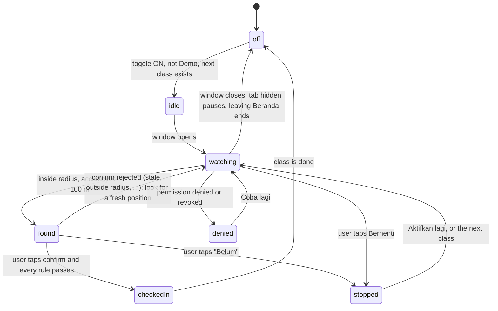

# Design Document: Berangkat Tepat Waktu

## Overview

A static, client-only Vite + React + TypeScript app. No backend, no auth. State lives in `localStorage`. The only network call is Open-Meteo weather.

Architecture principle: **pure logic core, thin I/O shell.** All rules (departure, XP, streak, stage, anti-cheat, backup validation) are pure TypeScript functions with injected time and no browser APIs, so they are easy to verify. Browser APIs (geolocation, fetch, localStorage, file download/upload) sit behind small adapters.



The Frankenstein stitch is visible in the code: `departure.ts` needs schedule + weather; `checkIn.ts` needs schedule + geo + time window; `xp.ts` needs the check-in outcome + weather + streak; `pet.ts` consumes XP. Each part depends on the previous one.

## Tech Stack

- Vite 8, React 19, TypeScript 7 (strict), plain CSS (no Tailwind), React Router is NOT used (four tabs held in state / simple hash route).
- Vitest for pure-logic tests (optional tasks).
- No runtime dependencies beyond React.
- Pin exact dependency versions.

## Project Structure

```
src/
  core/            # pure, no browser APIs
    types.ts
    time.ts        # parse HH:MM, window checks, minutesEarly
    geo.ts         # haversine
    departure.ts   # departure time + weather buffer
    weatherCodes.ts# isRain(code)
    xp.ts          # xp table, bonuses
    streak.ts      # streak derivation
    pet.ts         # stage from XP, progress
    badges.ts
    antiCheat.ts   # window, accuracy, freshness, travel speed
    checkIn.ts     # orchestrates a check-in decision
    backup.ts      # build + validate BackupV1
    stats.ts       # history statistics
  io/
    storage.ts     # versioned localStorage access
    weatherClient.ts
    geolocation.ts # promise wrapper + watch wrapper
    fileIO.ts      # download JSON, read file
  state/
    AppStateProvider.tsx
  hooks/
    useWeather.ts
    useCheckIn.ts
    useAutoGps.ts
    useNow.ts      # ticking clock, injectable
  screens/
    Beranda.tsx PetSaya.tsx Riwayat.tsx Pengaturan.tsx
  components/
    BottomNav.tsx TaskCard.tsx PetCompanion.tsx StreakWeek.tsx
    ResultCard.tsx AutoGpsIndicator.tsx ConfirmArrivalCard.tsx
    pets/ Egg.tsx Baby.tsx Teen.tsx Adult.tsx Legend.tsx
  strings/id.ts    # all Indonesian UI text
  styles/          # tokens.css, base.css, screens
```

All user-facing strings live in `strings/id.ts` so Bahasa Indonesia is auditable in one place.

## Data Model

Matches the source spec exactly.

```ts
interface Schedule {
  id: string; courseName: string;
  dayOfWeek: number;            // 0 = Sunday .. 6
  startTime: string;            // "HH:MM"
  campusName: string; latitude: number; longitude: number;
  radiusMetres: number;         // default 300
  travelMinutes: number;        // default 30
}

type CheckInStatus = "early" | "on_time" | "late" | "outside_radius";

interface CheckIn {
  id: string; scheduleId: string;
  date: string;                 // "YYYY-MM-DD" local
  arrivalTime: string;          // ISO
  minutesEarly: number;         // negative = late
  xpEarned: number;             // includes rain and streak bonus
  weatherCode: number | null;
  isDemo: boolean; isAutoGps: boolean;
  accuracyMetres: number | null;
  flaggedSuspicious: boolean;
  status: CheckInStatus;
}

interface Pet {
  totalXp: number; streakDays: number;
  lastCheckInDate: string | null;
  badges: string[];             // badge ids
}

interface Settings {
  autoGpsEnabled: boolean;      // false
  autoGpsWindowBeforeMin: number; // 60
  autoGpsWindowAfterMin: number;  // 15
}

interface BackupV1 {
  format: "tepatwaktu-backup"; version: 1; exportedAt: string;
  schedules: Schedule[]; checkIns: CheckIn[]; pet: Pet;
}
```

Additions beyond the source spec (local-only, clearly separated from `BackupV1` unless noted):

- `Campus { name, latitude, longitude, radiusMetres, defaultTravelMinutes }` stored under its own key; used as defaults when creating schedules.
- `Pet.badges` stays `string[]` per spec. Badge earned dates are derived from the earliest CheckIn that qualifies, so `BackupV1` keeps the exact spec shape. (A badge date is recomputed, not stored.)
- `demoModeEnabled: boolean` is a UI preference stored outside `Settings`/BackupV1 so the backup shape is unchanged. Import does not change it.

### Decision: `outside_radius` status

The union keeps `"outside_radius"` for spec parity, but failed attempts are never persisted (Requirement 5.7). The status is therefore never written by the app. The backup validator accepts the four literals and the app does not emit the fourth.

### localStorage keys

```
otp.v1.schedules   Schedule[]
otp.v1.checkIns    CheckIn[]
otp.v1.pet         Pet
otp.v1.settings    Settings
otp.v1.campus      Campus
otp.v1.ui          { demoModeEnabled: boolean }
```

`storage.ts` wraps reads in try/catch + shape validation (reusing the backup validators). Any failure returns the first-run default, never throws.

Writes happen through one `commit(nextState)` function that writes all keys, so state and storage do not drift. If a write fails (quota, private mode), `commit` returns false and tries to restore the previous values; the restore is best effort, not a guarantee. The provider then shows the "Data tidak bisa disimpan" banner and keeps the new state in memory only. A corrupt key falls back to its default on its own (for example a bad `schedules` key resets only schedules) and is reported in `loadIssues`.

The streak is derived in `AppStateProvider` from schedules, check-ins, and the clock (refreshed every 30 seconds). `Pet.streakDays` in storage is only a cache for display and backup. Deleting a class (`deleteSchedule`) never deletes its check-ins. Import (`replaceData`) replaces schedules, check-ins, and pet only; Settings, campus, and Demo Mode are left unchanged.

**Several tabs open at once (task 12.5).** Each tab keeps the whole state in memory and writes every key, so a stale tab used to overwrite the other tab's check-ins (reproduced in the task 8 walk: toggling Demo Mode in a stale tab erased a check-in and its XP). The fix has four parts:
- The provider keeps a RAW snapshot of what it last saw in storage, key by key. `reloadChanged` re-reads only the keys whose stored text differs; unchanged keys keep their object identity, so a form being typed in is not reset by an unrelated change in another tab.
- Every action calls `sync()` first, so it builds on the freshest data instead of this tab's stale copy. A check-in reads history through `actions.readLatest()` both before and after the GPS read, so a tab that missed every event still sees another tab's check-in and shows the existing result instead of awarding XP again (and does not read GPS for it).
- `sync()` also runs on the `storage` event, when the tab becomes visible, and on `pageshow`, because hidden or frozen tabs can miss events.
- `sync()` is skipped when this tab could not save (memory-only mode), because then memory legitimately differs from storage. The cached streak (`Pet.streakDays`) is only rewritten when this tab's own derived value changes, never because of a change that arrived from another tab, so two tabs whose clocks differ by a few seconds cannot rewrite each other forever.
Verified in a real browser: live update across tabs, no wipe on a stale save (also for a tab that never received events), both classes kept when two tabs add one each, typed text kept, clear-all propagates, and the two tabs stop writing after settling. Not covered: a true race inside the same few milliseconds in two tabs (no cross-tab lock), and browsers other than Edge.

**Known limit: delete and re-add (decision A, task 8).** The one-check-in-per-class-per-day rule is keyed by class id. Deleting a class and adding it again creates a new id, so a second check-in the same day is not blocked and awards XP again. Matching on the course name would not help (rename it) and would need a course-name field in BackupV1, which was rejected. Because students write their own schedule, an extra class can also be added at any time. This is accepted and disclosed in Pengaturan → Tentang and in the README (task 12.3). XP and the pet are a motivation tool, not proof of attendance. Import writes to a staging object first and commits only after full validation and confirm.

## Core Logic

### Time (`time.ts`)

- Local time is used for "today" and `date`. Class start for a given date = that date + `startTime` in local time.
- `minutesEarly(start: Date, arrival: Date) = floor((start' − arrival') / 60000)` where both are truncated to the minute first. Arrival at 09:00:xx for a 09:00 class gives 0 (on time); 09:01:00 gives −1 (late).
- `windowState(now, start, before=60, after=15)` returns `"before" | "open" | "closed"`. Inclusive at both ends.

### Departure and weather (`departure.ts`, `weatherCodes.ts`)

- `isRain(code)`: true for the WMO ranges 51–57 (drizzle, including freezing drizzle), 61–67 (rain, including freezing rain), 80–82 (rain showers), 95–99 (thunderstorm). The codes Open-Meteo actually reports in these groups are 51, 53, 55, 56, 57, 61, 63, 65, 66, 67, 80, 81, 82, 95, 96, 99. Everything else is clear, including fog (45, 48) and snow (71–77, 85, 86). Rain is decided by the weather code only (precipitation is shown in the UI but not used for the decision), because only the code is stored on a CheckIn and the rain bonus and "Hujan Pemberani" badge date must be re-derivable from saved data.
- `weatherBuffer(weather | null)` returns 20, 0, or 0 when null.
- `departure(start, travelMinutes, buffer)` returns a Date.

### Weather client (`weatherClient.ts`)

`GET https://api.open-meteo.com/v1/forecast?latitude={lat}&longitude={lng}&current=weather_code,precipitation` with `AbortController` timeout of 8 seconds. Coordinates are rounded to 2 decimals (about 1 km) before sending, so only a coarse campus point leaves the device; this is plenty for weather. Response shape is checked (`current.weather_code` and `current.precipitation` are numbers). Returns `WeatherResult | null`. Never throws. Cached in memory per campus for 10 minutes. `useWeather` exposes `{status: "loading"|"ok"|"unavailable", data}`.

### XP (`xp.ts`)

```
baseXp(minutesEarly):
  >= 30 -> 50
  15..29 -> 30
  0..14  -> 20     // 1..14 and exactly 0
  < 0    -> 0
```

Bonuses, applied only when `minutesEarly >= 0`:
- Rain bonus: +10 if rain at check-in. Badge `hujan_pemberani` on first.
- Streak bonus: +50 when this check-in makes the streak exactly 5 (once per run; a new run after a reset can earn it again). Badge `streak_5_hari` on first.
- `pagi_buta` badge when `minutesEarly >= 30`.

`xpEarned` on the CheckIn stores the sum of base and bonuses. Late check-ins always get 0 total.

### Streak (`streak.ts`)

The streak is derived, then cached in `Pet.streakDays` for display and backup:

`computeStreak(schedules, checkIns, today)` walks backward from today over calendar days:
- A day with no scheduled classes is skipped (does not break or extend).
- A day with classes and at least one `early`/`on_time` CheckIn extends the streak by 1.
- A day with classes and no early/on-time CheckIn breaks the walk, **except today**: today stays pending until its last class check-in window has closed.
- A `late` CheckIn on a day with no other early/on-time CheckIn breaks the streak.

The walk is bounded to the oldest CheckIn date or 365 days. Because the app only runs when opened, streak reset for missed days happens lazily on app open and after each check-in, which gives the same result as a nightly job.

Caveat (documented): schedule edits change history interpretation (a class deleted today removes yesterday's "missed" day). This is acceptable for a motivation tool.

### Pet (`pet.ts`)

`stageForXp(xp)`: <100 `telur`, <300 `bayi`, <600 `remaja`, <1000 `dewasa`, else `legenda`. `progress(xp)` returns `{stage, nextStage, xpIntoStage, xpForNext, ratio}`. For Telur 75/100: ratio 0.75, 25 XP to go. Legenda has no next stage.

### Statistics (`stats.ts`)

On-time percentage and average minutes early exclude DEMO check-ins (they are not real arrivals). Total XP is the pet's total, which includes everything awarded, so it includes demo XP. The History screen must state that the on-time percentage and average count real arrivals only (see Riwayat). Longest streak is computed from completed days: today counts only once it has an early or on-time check-in, and a late check-in today does not end a run while another class that day is still reachable. The current streak, by contrast, drops immediately on a late check-in today and recovers if an on-time check-in follows the same day.

### Anti-cheat (`antiCheat.ts`)

Ordered pipeline, first failure wins. Each returns a typed reason that maps to a string key.

```
checkTimeWindow(now, start)          -> ok | outside_window
checkAccuracy(accuracy)              -> ok | low_accuracy   (> 100 m rejected; 100 passes)
checkFreshness(now, positionTs)      -> ok | stale          (> 120 s rejected; 120 passes)
(radius check)                       -> ok | outside_radius
(duplicate check)                    -> ok | already_checked_in
impliedSpeedKmh(prev, next)          -> number | null
```

Pipeline order in `checkIn.ts`: duplicate → time window → accuracy → freshness → radius. (Duplicate first so the existing result shows without noise; the other four follow the spec's order.) Impossible-travel runs after a pass and only sets a flag.

Impossible travel: previous = latest non-demo CheckIn by `arrivalTime`. Distance = haversine between the two classes' campus points (not the user's position, which is never stored). `speed = distanceKm / hours`. If `hours` is 0 or very small and distance > 0, speed is treated as above the limit. Flag when `speed > 200`. If both classes are at the same campus (distance 0), no flag. Demo CheckIns are excluded on both sides.

Honest limits (shown in Settings → "Tentang pengecekan"): browser GPS can be spoofed, this is a motivation tool.

### Check-in orchestration (`checkIn.ts`)

```ts
decideCheckIn(input: {
  schedule, now, position | null, weather, existingCheckIns, pet,
  isDemo, isAutoGps, schedules
}): { ok: true; checkIn: CheckIn; petAfter: Pet; newBadges: string[] }
   | { ok: false; reason: Reason; existing?: CheckIn }
```

Pure. The hook does the I/O (read position), calls `decideCheckIn`, and commits on `ok`. In Demo Mode `position` is synthesised at the campus point with accuracy 10 m and timestamp = now; it still passes through the time window and duplicate checks so demo behaves like the real flow, but accuracy, freshness, and impossible-travel are skipped for demo.

### Backup (`backup.ts`)

- `buildBackup(state, now): BackupV1`.
- `parseBackup(text): {ok: true; backup} | {ok: false; error: "too_large" | "unrecognised" | "invalid"; detail?: string}`. `detail` names the first failing field for developers and is never shown to the user.
- `summarizeBackup(backup)` returns class count, check-in count, and total XP for the import summary. `backupFileName(now)` returns `tepatwaktu-backup-v1-YYYY-MM-DD.json`.
- Validation is hand-written type guards (no schema lib), checks: object type, `format`, `version`, each Schedule (HH:MM regex, dayOfWeek integer 0..6, lat/lng ranges, radius > 0, travel ≥ 0, non-empty strings), each CheckIn (valid date key, parseable ISO arrival time, integer minutes and XP, finite accuracy ≥ 0 or null, integer weather code or null, `status` union, status consistent with minutesEarly for early/on_time/late, booleans), Pet (non-negative integer XP, non-negative integer streak, `lastCheckInDate` valid date key or null, badges a list of non-empty unique strings), and unique ids within schedules and within check-ins.
- Decision: a CheckIn's `scheduleId` is NOT required to match an existing Schedule. A student can delete a class and keep its history, so a legitimate export can contain such check-ins. The UI shows "Kelas dihapus" for them. Rejecting these would make users' own exports fail to import.
- Pet totals are not cross-checked against check-in XP, because the opt-in sample data and future bonus rules would not add up. A backup is the user's own data and is not tamper-proof.
- Any failure rejects the whole file. Unknown extra fields are ignored and dropped on import. Validated values are copied field by field into new objects.
- A file size cap of 2 MB is applied before parsing.
- Round-trip rule: `parseBackup(JSON.stringify(buildBackup(s)))` yields state equal to `s`.
- Not part of BackupV1: Settings, Campus, and UI preferences (Demo Mode). After an import on a new phone, the user re-checks Auto GPS and Demo Mode (both stay OFF) and campus defaults come from the imported schedules.

Error message mapping: `unrecognised` → "File backup tidak dikenali." followed by "Data kamu tidak diubah."; `invalid` → "File backup rusak atau tidak sesuai format. Data kamu tidak diubah."; `too_large` → "File backup terlalu besar. Data kamu tidak diubah."; unreadable file → "File tidak bisa dibaca. Data kamu tidak diubah."

**Export and import UI (task 11)**, in Pengaturan → "Cadangan dan pindah HP" (`BackupSection`):
- Export builds the file from the app state with today's DERIVED streak, pretty-prints it, and downloads `tepatwaktu-backup-v1-YYYY-MM-DD.json` (local date). Exporting writes nothing.
- Import flow: pick (a hidden file input behind a button) → read (a file over 4 MB is refused before it is loaded) → `parseBackup` (2,000,000-character cap, format and version, then every entry) → a dialog with the file's counts, the file's export date, the CURRENT data that would be replaced, and the exact replace warning → an explicit "Ya, ganti data". Nothing is written before that tap. Escape, "Batal", and every error leave storage byte-for-byte unchanged. Errors show in a `role="alert"` box with the "data tidak diubah" assurance.
- What is replaced: schedules, check-ins, and pet (`replaceData`). Settings, Auto GPS, Demo Mode, and an existing campus are never touched.
- Campus after import: because the campus is not in BackupV1, a device with NO campus gets one derived from the imported classes (`deriveCampus`: the most common campus point among them), so "Tambah jadwal" works at once. A campus the user already has is never replaced. The success message says when this happened.
- If the browser cannot save the imported data (quota, private mode), the section shows an honest warning and the global storage banner appears. Storage is not half-written (the old stored data stays), but the imported data is held in memory only until the page closes.
- Other open tabs pick up the imported data by themselves (see the several-tabs paragraph).
- Honest copy on the card: there is no account and no automatic sync (how to move phones by hand), what is and is not in the file, and that the file is the user's own editable data and not proof of attendance.
- The streak is derived, so it is recomputed after an import using the importing day's clock. Restored "exactly" holds on the same day; a file imported days later can legitimately show a lower current streak if days were missed in between.

## Hooks and I/O

### `useCheckIn`
1. If Demo Mode is ON, synthesise position. Otherwise call `getCurrentPosition` once with `{ enableHighAccuracy: true, timeout: 15000, maximumAge: 0 }`.
2. Map `GeolocationPositionError` codes: 1 → permission denied, 2/3 → unavailable.
3. Call `decideCheckIn`; on `ok`, commit and show the result card; on failure show a transient message.

### `useAutoGps`
Status is DERIVED, not stored, from these facts: toggle, Demo Mode, the next class (state `berikutnya`) and whether its window is open, plus a few per-class-per-day memory flags (stopped, denied, window closed) and the detected position.

| Status | Meaning | Shown |
| --- | --- | --- |
| `off` | toggle off, Demo Mode on, no class waiting, or the window just closed | nothing |
| `idle` | toggle on, window not open yet. No location is read | "GPS otomatis menunggu jendela check-in (mulai pukul HH:MM). Lokasi belum dibaca." |
| `watching` | window open, `watchPosition` running | "GPS aktif, mencari posisi kampus" + Berhenti |
| `found` | inside the radius with accuracy at most 100 m. Watching has stopped | confirm card |
| `stopped` | user tapped stop or "Belum". Stays off for THIS class today | "GPS otomatis dihentikan sementara." + Aktifkan lagi |
| `denied` | permission denied or revoked | message + Coba lagi (the manual button still works) |
| `unsupported` | the browser has no geolocation | message |


- Mounted only by Beranda. Leaving Beranda ends the watch. The effect depends only on stable values (status, class-and-day key, a restart counter), not on the task objects, which are rebuilt every 30 seconds; the callbacks read the latest values through refs. Otherwise the watch would restart every tick.
- Low frequency: `watchPosition` with `enableHighAccuracy: false`, and updates closer than 15 seconds apart are dropped in `io/geolocation.ts`.
- The window is enforced three ways: the status only becomes `watching` while the window is open; a timer ends the watch at the exact close moment (start + after + 1 minute), not at the next 30-second tick; and every position callback re-checks the window with a fresh clock, so a late callback can never produce a card after the window closed.
- A hidden tab pauses reading and a visible tab resumes it, because a hidden tab is not "Beranda is open". This is stricter than the original spec text.
- On a position inside the radius with accuracy at most 100 m: stop watching and show the card. No CheckIn is created.
- Confirm calls the same `useCheckIn` path as a manual tap, with the detected position handed in and `isAutoGps: true`. It re-runs every rule at that moment: duplicate, time window, accuracy, freshness (a card left open for more than 120 seconds fails here with the stale message), radius, XP, streak, impossible-travel flag. On a rejection the hook goes back to looking for a fresh position.
- "Belum" and Berhenti both mean "stop for this class today". Without that, a declined card would come straight back. The stop choice is held in memory only, so reloading the page forgets it and watching starts again.
- Permission: a watch error with code 1 and a `navigator.permissions` change to `denied` both lead to `denied`. Other errors (no fix yet, timeout) are ignored and the browser keeps trying.
- The detected position is React state in memory only. It is dropped as soon as the status is no longer `found`. It is never written to localStorage, sessionStorage, or the backup.
### Honest scope in UI
Settings explanation text: "GPS otomatis hanya berjalan saat halaman Beranda terbuka dan hanya di jendela check-in. Tidak berjalan di latar belakang."

## Screens and UI Design

### Visual direction

Calm, friendly, school-appropriate. Original visual language:
- Primary action blue (`--blue-600`), neutral warm-white background, deep ink text, soft amber for XP and streak accents, rose for late/sad states, teal for "done".
- Not green-and-orange, and no feather/owl/flame characters. The streak icon is an original sunrise-over-book glyph drawn in SVG. The pet is original egg and creature shapes.
- Rounded cards, generous spacing, 16px base font, 48px minimum tap targets.

### Beranda (Home)

Task-tracker structure with companion on top:

```
┌────────────────────────────────┐
│ Minggu, 8 November             │  header: date + streak chip (🌅 3 hari)
│ ┌────────────────────────────┐ │
│ │ [Pet SVG: Telur]           │ │  companion card
│ │ Telur  ▓▓▓▓▓▓▓░░ 75/100 XP │ │  progress bar, "25 XP lagi jadi Bayi"
│ │ S  S  R  K  J  S  M        │ │  seven-day streak row (done/missed/today)
│ └────────────────────────────┘ │
│ Cuaca: Hujan ringan  ☂ +20 mnt │  weather strip (or fallback text)
│                                │
│ Tugas hari ini                 │  task list
│ ◉ 09:00 Pemrograman Web        │  NEXT: expanded card
│    Berangkat 07:50 (30+20 mnt) │
│    [ Saya sudah sampai ]       │  blue primary button
│ ○ 13:00 Basis Data   (nanti)   │
│ ✓ 07:30 Etika (selesai +30 XP) │
│                                │
│ [GPS aktif… Berhenti]          │  auto GPS indicator (conditional)
├────────────────────────────────┤
│ Beranda | Pet Saya | Riwayat | Pengaturan │ bottom nav (4 items)
└────────────────────────────────┘
```

Implementation notes (task 6):
- `core/tasks.ts` builds today's list. Exactly one class is `berikutnya`: the earliest class with no check-in whose window is not closed. Only it gets the button. A class with an open window that started earlier wins over a later upcoming class.
- The button is always enabled for the next class. Before the window opens, the card says "Check-in dibuka pukul HH:MM." and a tap shows the outside-window message. `precheckCheckIn` (duplicate, then window) runs BEFORE any GPS read, so a tap that is going to be rejected never reads location.
- A second in-flight tap is ignored (busy guard), so a double tap cannot create two attempts.
- Departure wording has three states: upcoming ("Berangkat pukul HH:MM"), passed ("Seharusnya berangkat pukul HH:MM. Berangkat sekarang!"), and classStarted ("Kelas sudah dimulai."). Weather is requested only when there is a class today, for the next class's campus point.
- Pet mood (`petMood`) reflects today's latest check-in only: happy after early or on time, sad after late, calm otherwise. It never stays sad for days.
- The streak row shows the last 7 days. Days before the first-ever check-in show as neutral, not missed. Each day has an icon and hidden text, never colour alone.
- Result cards: a full card right after a check-in (breakdown, badges, stage-up, dismiss) and a compact line inside each finished task. DEMO check-ins carry the DEMO chip and the text "bukan dari GPS". A real check-in says only "Posisi terbaca di dalam area kampus." and never uses "verified" wording.
- Pet SVGs (task 7.1) were built early because the companion needs every stage.

Task states: `selesai` (checked in, shows XP), `berikutnya` (next, expanded), `nanti` (upcoming), `terlewat` (window closed with no check-in). Only the next task shows the button. The result card replaces the button area after check-in. The Demo banner "MODE DEMO" shows above the header when ON. Auto GPS confirm card slides above the task list.

First-run state shows the pet at 0 XP and a prompt to set the campus and add a class.

Design reference fixture: Telur at 75/100 XP, streak 3, one class today. Provided as `src/fixtures/sample.ts` and loadable only through the "Muat data contoh" action in Pengaturan → Data, behind a confirm dialog that says it replaces schedules, check-ins, XP, and pet, and that sample check-ins are DEMO. How the sample is built:
- Four classes on four different weekdays (today and the three days before). Today's class starts about 45 minutes from now (rounded up to 5 minutes, never after 23:55), so its check-in window is open and the button can be tried at once.
- Three earlier check-ins on the three previous days, all `isDemo: true` with no accuracy, so none of it counts as a real arrival and it is excluded from the on-time percentage and average. They give a streak of 3.
- The pet's 75 XP is a fixed sample value. XP awards are multiples of 10, so no real history can add up to exactly 75 (this is also why pet totals are not cross-checked against check-ins).
- No weather in the sample: today's weather always comes live from Open-Meteo, so "rain" in the design reference is not reproduced.
- The user's own campus is kept when one exists, so the sample class can be tried at their real campus; otherwise a labelled "Kampus Contoh" is saved. Settings, Auto GPS, and Demo Mode are never changed. The status message after loading tells the user to switch on Demo Mode to try a check-in without GPS.
- Loading is done through `replaceData(state, campus?)`, the same replace path as import.

### Pet Saya
Implementation notes (task 7): the pet mood is the same `petMood` as on Home (today's latest check-in only). Beside the stage and XP bar, the screen lists all five stages with their start XP (0, 100, 300, 600, 1000) and marks reached, current, and not yet. Earned badges come from `Pet.badges`; the earned date is derived from check-ins by `badgeEarnings`. If a badge is in `Pet.badges` but no date can be derived (for example after deleting classes or loading data without history), the card says "Tanggal tidak tercatat" instead of inventing one. A badge earned from a DEMO check-in carries a "dari DEMO" chip. For "Pagi Buta" and "Hujan Pemberani" that is the earliest qualifying check-in; for "Streak 5 Hari" it is labelled when the streak could not have reached 5 without DEMO check-ins. The screen also shows the same "Total XP termasuk XP dari DEMO." note as Riwayat. The XP bar is a shared component (`XpProgress`) used by Home and Pet Saya.

Large pet SVG for the stage, stage name, total XP, progress bar, XP to next stage, streak, badge grid (earned with date, locked ones greyed with hint). Sad pose when the most recent CheckIn was late.

### Riwayat
Stats row (percentage on-time this month, average minutes early, longest streak, total XP) with a visible note under the first two: "Hanya kedatangan nyata, tidak termasuk DEMO." Total XP carries a note that it includes XP from DEMO. Then a list of CheckIns (a check-in whose class was deleted shows "Kelas dihapus"). Each row: date, course, time, early/late text, XP, weather icon + label, DEMO chip, "Perjalanan tidak wajar" chip.

### Pengaturan
Implementation notes (task 5): a new class copies the campus point; editing a class keeps the class's own point. Because check-in uses each class's own point, saving a changed campus shows "Terapkan ke N jadwal" when classes still hold the old point. Adding a class is blocked until a campus is set. Deleting a class never deletes its check-ins. Navigation is a hash route (`#/beranda`, `#/pet`, `#/riwayat`, `#/pengaturan`); focus moves to the new screen only on a real route change. `html` has `scroll-padding-bottom` so focused fields stay clear of the fixed bottom nav.

Sections: Kampus (name, lat, lng, radius, default travel, "Pakai lokasi saya"), Jadwal Kuliah (list + add/edit form + delete confirm), GPS Otomatis (toggle + explanation), Mode Demo (toggle + explanation), Data (Export, Import, Hapus semua data), Tentang (honest scope: motivation tool, GPS can be spoofed, no WiFi or mock-location checks).

Import flow is a small modal state machine: `pick → validating → summary+warning → confirm → done`, or `error`. Nothing is written until `confirm`.

### Pet SVG
Five components under `components/pets/`, each a pure SVG with `viewBox="0 0 160 160"`, `role="img"` and Indonesian `aria-label`. Props: `mood: "senang" | "biasa" | "sedih"`. Legenda adds a crown and glow. No external assets.

### Accessibility
Semantic landmarks (`header`, `main`, `nav`), `aria-current="page"` on the active nav item, `aria-live="polite"` for check-in results and the GPS indicator, focus moved to modals, no colour-only state (icons and text accompany colour), `prefers-reduced-motion` disables pet animation.

**Polish audit (task 12.1).** An automated audit measures the real rendered DOM in about 20 UI states (first run, empty states, result and confirm cards, failure messages, banners, dialogs, forms with errors) instead of trusting the CSS. It checks:
- text contrast (4.5:1, or 3:1 for large text), and 3:1 for meaningful graphics and control borders;
- accessible names on every control, one `h1` per screen with no skipped heading level, landmarks, unique ids, and that every `aria-labelledby`/`aria-describedby` target exists;
- a visible focus ring (at least 2px and 3:1) on every keyboard stop;
- no horizontal overflow and tap targets of at least 44px at 320, 360, 390, 768 and 1280px;
- `prefers-reduced-motion`, keyboard-only use of the main button, a focus trap in dialogs, Escape, and focus returning to the opener.

It found and fixed: the focus ring (amber, about 2:1) is now a dark amber `--amber-700` at 5.6:1 or better; form field borders were 1.6:1 and now use `--ink-500`; the "today, not yet checked in" streak mark, the "later" task marker and the badge icons were 1.5–2.5:1 and now use `--ink-500` or `--amber-700`. `--ink-300` and `--amber-500` remain only for decoration. Closed dialogs no longer point `aria-labelledby` at ids that exist only while open. On wide screens the bottom bar now matches the 520px content column. This is automated checking only: it is not full WCAG validation, which needs manual testing with assistive technology.

## Deploy (task 12.4)

A static site, no server code. `vite.config.ts` sets `base: "./"` so asset URLs are relative and the build works at a domain root and under a sub-path; routing is hash-based, so no rewrites. `vercel.json` (the only deploy config, by decision; a Netlify file was removed so two configs never have to be kept in sync) carries the build command, `dist` as the output, long-lived caching for the hashed `/assets/*`, and the security headers. Vercel reads the Node version from the `engines` field in `package.json`. The headers are: a Content-Security-Policy that allows only `'self'` plus `https://api.open-meteo.com` for connections (no inline scripts or styles, no eval), `X-Content-Type-Options: nosniff`, `Referrer-Policy: no-referrer`, and `Permissions-Policy: geolocation=(self)` with camera, microphone and payment off. React sets inline styles through the DOM (the progress bar width), which the CSP allows. The headers were verified by serving the built site with the exact `vercel.json` headers locally; they have not been run on the real hosts.

## Error Handling

| Situation | Behaviour |
| --- | --- |
| Weather fails | Buffer 0, fallback text, everything else works |
| GPS denied / unavailable | Indonesian message, 0 XP, Demo Mode suggestion |
| Outside radius, low accuracy, stale, outside window | Transient message, 0 XP, nothing stored |
| Corrupt localStorage | First-run defaults, no crash |
| localStorage write fails (quota/private mode) | Banner "Data tidak bisa disimpan di browser ini" |
| Bad backup file | Reject whole file, state unchanged |

## Correctness Properties (for optional property/unit tests)

1. XP is a function of minutesEarly: monotonic non-increasing as arrival gets later; late always 0; boundaries at 30, 15, 1, 0 and −1.
2. `stageForXp` changes exactly at 99→100, 299→300, 599→600, 999→1000.
3. A second `decideCheckIn` for the same schedule and date never changes `totalXp`.
4. For any pet state and non-ok outcomes, state is unchanged (no partial writes).
5. `parseBackup(buildBackup(s))` equals `s`; mutating any single field to an invalid value yields rejection.
6. `checkAccuracy(100)` ok, `(100.01)` rejected; `checkFreshness` ok at 120 s, rejected at 121 s.
7. Auto GPS never calls `watchPosition` when toggle is off, when Demo Mode is on, or when `windowState !== "open"`.
8. No code path writes user latitude/longitude to storage or export.

## Requirements Traceability

| Requirement | Main modules |
| --- | --- |
| 1, 2 | `Pengaturan`, `storage`, validation in `types`/`backup` |
| 3 | `Beranda`, `TaskCard`, `PetCompanion`, `StreakWeek`, `BottomNav` |
| 4 | `departure`, `weatherCodes`, `weatherClient`, `useWeather` |
| 5 | `useCheckIn`, `geo`, `checkIn`, `geolocation` |
| 6, 7 | `xp`, `streak`, `pet`, `badges`, `PetSaya`, `pets/*` |
| 8 | `stats`, `Riwayat` |
| 9 | `useAutoGps`, `AutoGpsIndicator`, `ConfirmArrivalCard` |
| 10 | `antiCheat`, `checkIn` |
| 11 | `checkIn` (demo path), UI banner |
| 12 | `backup`, `fileIO`, import modal |
| 13 | `storage.clearAll`, `Pengaturan` |
| 14, 15 | project config, `strings/id.ts`, README, `.kiro/` |

## Open Questions (defaults chosen; please confirm or change)

1. **Pet starting at Telur 75/100 XP.** A real new user earning 75 XP for free would be fake progress and conflict with "grows only from real arrivals". Default: new users start at 0 XP; 75/100 is the design reference and an opt-in sample-data action. If you want 75 XP as the real first-run value, say so and I will change Requirement 7.3 and label it as a welcome bonus.
2. **Streak bonus repeat.** Source spec says "5 consecutive streak days: +50 XP". Default: awarded once each time a run reaches exactly 5 (not at 10, 15), badge once ever.
3. **Minute truncation.** Arrival seconds are dropped before comparing, so 09:00:40 for a 09:00 class is "tepat waktu" (20 XP), and 09:01:00 is late. Alternative: compare with seconds, which makes 09:00:01 late.
4. **Late check-ins are recorded** (up to 15 minutes after start) with 0 XP because the source spec resets the streak on a late check-in and shows history. After the window closes, no check-in is possible and the class is "terlewat".
5. **Calendar library.** Plain `Date`, local timezone, no date library.
